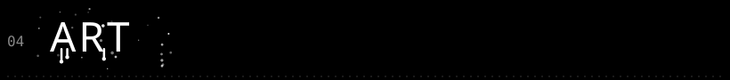

<div align="center">


</div>


I'm Nomad. I make small, slightly weird tools and a lot of half-finished experiments, usually late at night. If something annoys me enough, I'll build my own fix for it. I'm always up for teaming up on something fun.

```
working on   the thing I can't stop thinking about (edit me)
learning     something new, as usual (edit me)
ask me about whatever you're curious about (edit me)
based in     all over, for now
```


<a href="https://github.com/nomadx3dg/PROJECT_ONE"></a>
<a href="https://github.com/nomadx3dg/PROJECT_TWO"></a>
<a href="https://github.com/nomadx3dg/PROJECT_THREE"></a>

```
project_one     a quick line on what it does and why I made it
project_two     a quick line on what it does and why I made it
project_three   a quick line on what it does and why I made it
```




<p align="center">
  
  
</p>


```
nothing playing right now
```

<sub>via YouTube Music</sub>


Want to help out? Fork the repo, make a branch, and send me a pull request. Small fixes are totally welcome. If you're not sure where to start, open an issue and say hi.


[Email](mailto:you@example.com) / [Website](https://example.com) / [X](https://x.com/yourhandle)


<div align="center"><sub>always on the move.</sub></div>
