

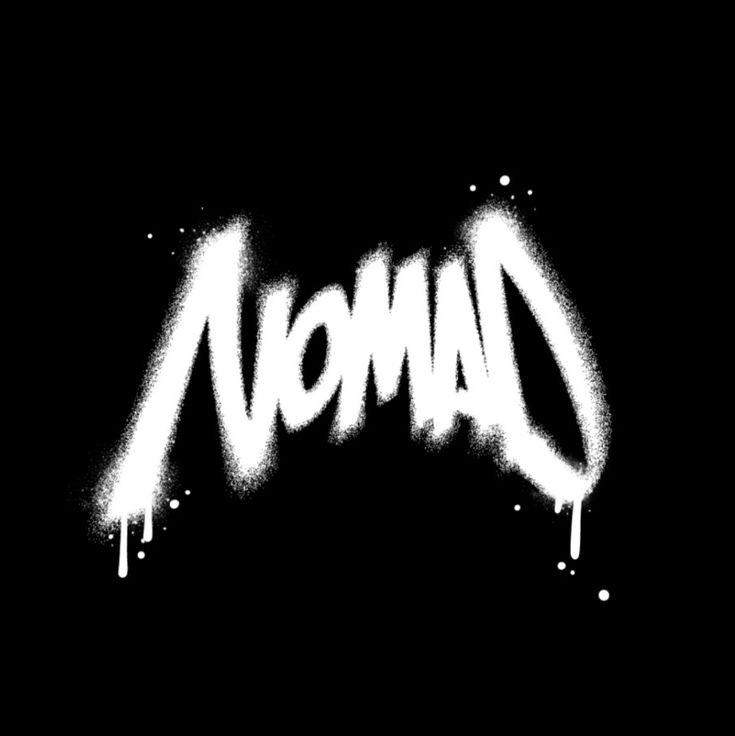


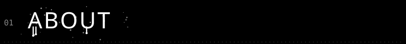

I'm Nomad. I make small, slightly weird tools and a lot of half-finished experiments, usually late at night. If something annoys me enough, I'll build my own fix for it. I'm always up for teaming up on something fun.

**working on:** the thing I can't stop thinking about 
**learning:** something new, as usual 
**ask me about:** whatever you're curious about 
**based in:** Indonesia

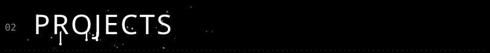

<a href="https://github.com/nomadx3dg/cubicle">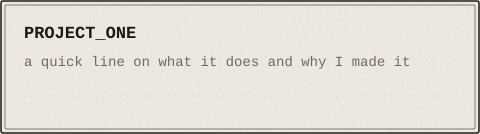</a>

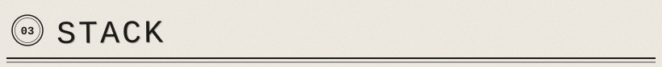

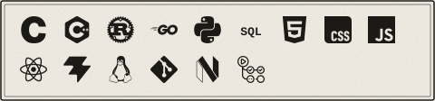

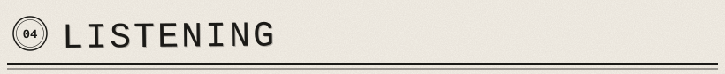

**last played: Passion Mango - Spinning Out**  
[Open on Last.fm](https://www.last.fm/music/Passion+Mango/_/Spinning+Out)

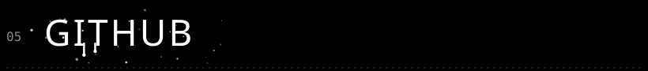

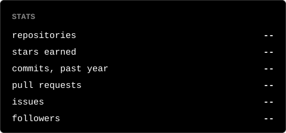

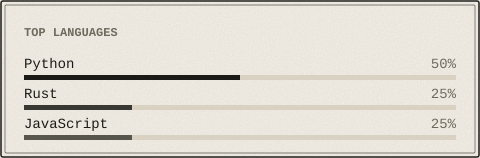

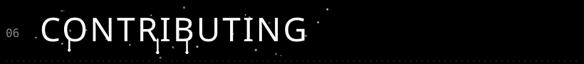

Want to help out? Fork the repo, make a branch, and send me a pull request. Small fixes are totally welcome. If you're not sure where to start, open an issue and say hi.

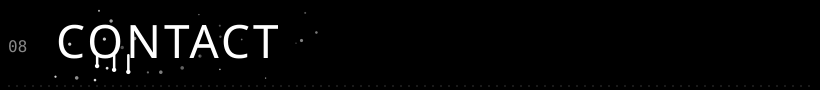

&nbsp;&nbsp;&nbsp;&nbsp;<a href="https://www.tiktok.com/@nomadx3dg">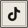</a>

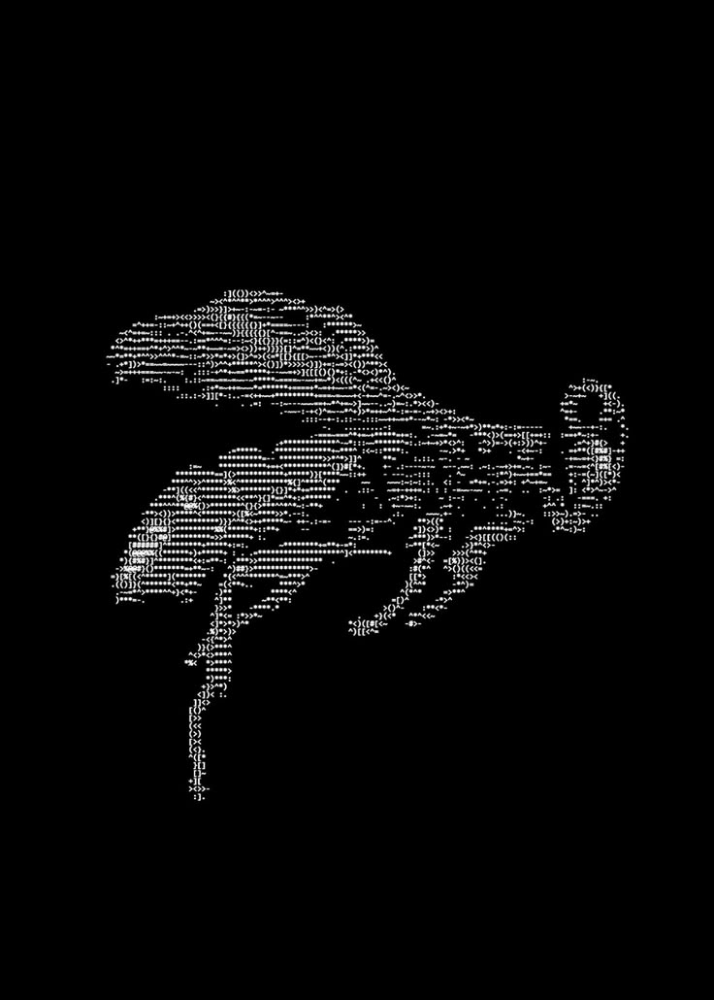

always on the move.

