

<picture><source media="(prefers-color-scheme: dark)" srcset="assets/img/logo-dark.png"></picture>

<picture><source media="(prefers-color-scheme: dark)" srcset="assets/dark/tagline.svg"></picture>

<picture><source media="(prefers-color-scheme: dark)" srcset="assets/dark/divider.svg"></picture>

<picture><source media="(prefers-color-scheme: dark)" srcset="assets/dark/h-about.svg">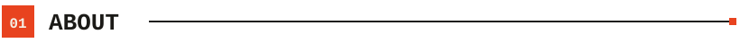</picture>

I'm Nomad. I make small, slightly weird tools and a lot of half-finished experiments, usually late at night. If something annoys me enough, I'll build my own fix for it. I'm always up for teaming up on something fun.

<picture><source media="(prefers-color-scheme: dark)" srcset="assets/dark/status.svg">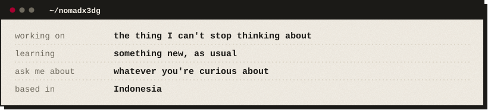</picture>

<picture><source media="(prefers-color-scheme: dark)" srcset="assets/dark/h-stack.svg">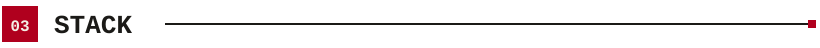</picture>

<picture><source media="(prefers-color-scheme: dark)" srcset="assets/dark/stack.svg">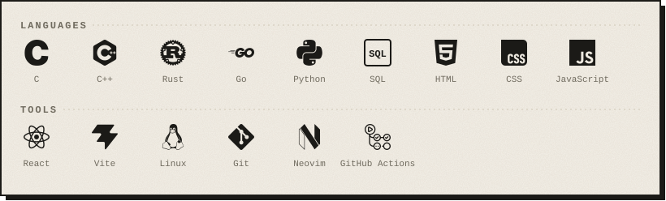</picture>

<picture><source media="(prefers-color-scheme: dark)" srcset="assets/dark/h-recent.svg">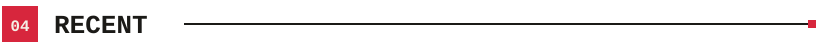</picture>

<a href="https://github.com/nomadx3dg"><picture><source media="(prefers-color-scheme: dark)" srcset="assets/dark/recent.svg">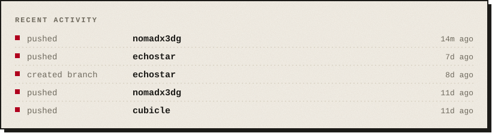</picture></a>

<picture><source media="(prefers-color-scheme: dark)" srcset="assets/dark/h-activity.svg">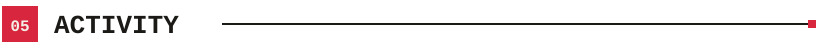</picture>

<picture><source media="(prefers-color-scheme: dark)" srcset="assets/dark/stats.svg">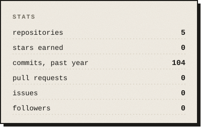</picture>
<picture><source media="(prefers-color-scheme: dark)" srcset="assets/dark/langs.svg">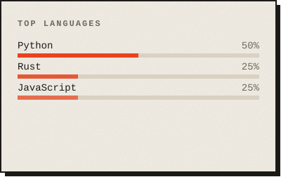</picture>

<picture><source media="(prefers-color-scheme: dark)" srcset="assets/dark/h-contact.svg"></picture>

<a href="mailto:moqxcz@gmail.com"><picture><source media="(prefers-color-scheme: dark)" srcset="assets/dark/social-email.svg">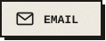</picture></a>
<a href="https://nomadx3dg.vercel.app"><picture><source media="(prefers-color-scheme: dark)" srcset="assets/dark/social-website.svg">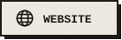</picture></a>
<a href="https://www.tiktok.com/@nomadx3dg"><picture><source media="(prefers-color-scheme: dark)" srcset="assets/dark/social-tiktok.svg">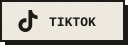</picture></a>

<picture><source media="(prefers-color-scheme: dark)" srcset="assets/dark/divider.svg"></picture>

<picture><source media="(prefers-color-scheme: dark)" srcset="assets/img/ascii-dark.png">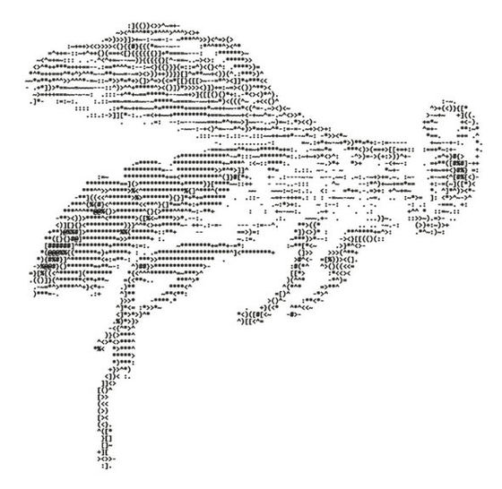</picture>

always on the move.

