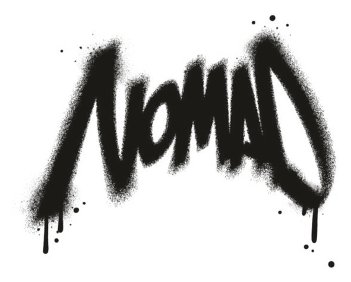

<picture><source media="(prefers-color-scheme: dark)" srcset="assets/img/logo-dark.png"></picture>

<picture><source media="(prefers-color-scheme: dark)" srcset="assets/dark/tagline.svg?v=13993d41"></picture>

<picture><source media="(prefers-color-scheme: dark)" srcset="assets/dark/divider.svg?v=08ad34cb"></picture>

<picture><source media="(prefers-color-scheme: dark)" srcset="assets/dark/h-about.svg?v=09c42f60"></picture>

I'm Nomad, a student and a maker. I'm into philosophy, programming and drawing, and I want to invent things. I'm autistic, and I build small, slightly weird tools and half-finished experiments, usually late at night. If something annoys me enough, I'll build my own fix for it. Always up for teaming up on something fun.

<picture><source media="(prefers-color-scheme: dark)" srcset="assets/dark/status.svg?v=f751b20a"></picture>

<picture><source media="(prefers-color-scheme: dark)" srcset="assets/dark/h-projects.svg?v=2a55098f"></picture>

<a href="https://github.com/nomadx3dg/cubicle"><picture><source media="(prefers-color-scheme: dark)" srcset="assets/dark/pin-1.svg?v=c1a76d0b"></picture></a>
<a href="https://github.com/nomadx3dg/echostar"><picture><source media="(prefers-color-scheme: dark)" srcset="assets/dark/pin-2.svg?v=0a5d8ebb"></picture></a>

<a href="https://github.com/nomadx3dg/bareboxn"><picture><source media="(prefers-color-scheme: dark)" srcset="assets/dark/pin-3.svg?v=8a0972fe"></picture></a>

<picture><source media="(prefers-color-scheme: dark)" srcset="assets/dark/h-stack.svg?v=034fa282"></picture>

<picture><source media="(prefers-color-scheme: dark)" srcset="assets/dark/stack.svg?v=33b3cf81"></picture>

<picture><source media="(prefers-color-scheme: dark)" srcset="assets/dark/h-latest.svg?v=514eed82"></picture>

<a href="https://github.com/nomadx3dg"><picture><source media="(prefers-color-scheme: dark)" srcset="assets/dark/latest.svg?v=0df7632c"></picture></a>

<picture><source media="(prefers-color-scheme: dark)" srcset="assets/dark/h-activity.svg?v=2367f981"></picture>

<picture><source media="(prefers-color-scheme: dark)" srcset="assets/dark/heatmap.svg?v=64b6620d"></picture>

<picture><source media="(prefers-color-scheme: dark)" srcset="assets/dark/langs-wide.svg?v=64570d5a"></picture>

<picture><source media="(prefers-color-scheme: dark)" srcset="assets/dark/h-wall.svg?v=4173e471"></picture>

<picture><source media="(prefers-color-scheme: dark)" srcset="assets/dark/wall.svg?v=b95c3488"></picture>

<a href="https://github.com/nomadx3dg/nomadx3dg/issues/new?template=paint.yml"><picture><source media="(prefers-color-scheme: dark)" srcset="assets/dark/paint-btn.svg?v=d7b9ebf7"></picture></a>

pick a spot and a colour, a bot paints it and redraws the wall.

<picture><source media="(prefers-color-scheme: dark)" srcset="assets/dark/h-contact.svg?v=c31b9918"></picture>

<a href="https://github.com/nomadx3dg"><picture><source media="(prefers-color-scheme: dark)" srcset="assets/dark/social-github.svg?v=c2edae75"></picture></a>
<a href="mailto:moqxcz@gmail.com"><picture><source media="(prefers-color-scheme: dark)" srcset="assets/dark/social-email.svg?v=1b10e2aa"></picture></a>
<a href="https://nomadx3dg.vercel.app"><picture><source media="(prefers-color-scheme: dark)" srcset="assets/dark/social-website.svg?v=b7e471eb"></picture></a>
<a href="https://www.tiktok.com/@nomadx3dg"><picture><source media="(prefers-color-scheme: dark)" srcset="assets/dark/social-tiktok.svg?v=144f9e1d"></picture></a>

<picture><source media="(prefers-color-scheme: dark)" srcset="assets/dark/divider.svg?v=08ad34cb"></picture>

<picture><source media="(prefers-color-scheme: dark)" srcset="assets/img/ascii-dark.png"></picture>

always on the move.

